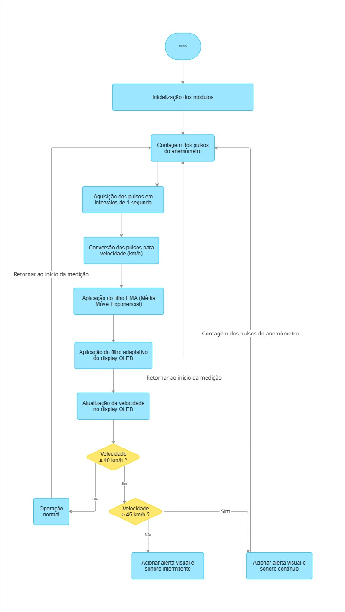

# Sistema de Alarme Sonoro e Visual para Segurança em Trabalho em Altura Baseado no Monitoramento da Velocidade do Vento

Projeto desenvolvido na disciplina de **Sistemas Microcontrolados** com o objetivo de monitorar a velocidade do vento em tempo real e emitir alertas visuais e sonoros quando condições de risco forem identificadas.

O sistema utiliza um **Arduino Uno**, um sensor baseado em **Reed Switch**, um **display LCD 20x4 com interface I²C (PCF8574)** para visualização dos dados e dispositivos de alerta para aumentar a segurança em operações de trabalho em altura.

---

## Integrantes

- Fabio Rodrigues Moreira
- Nicole Aguiar Costa Mazzoni
- Rafael Pinheiro Silva
- Gustavo Henrique dos Santos Duarte
- Caio Silva Marinho

---

## Objetivo

Desenvolver um sistema embarcado capaz de:

- Medir a velocidade do vento em tempo real;
- Exibir as informações ao usuário por meio de um display LCD;
- Alertar operadores quando forem detectadas velocidades potencialmente perigosas;
- Auxiliar na prevenção de acidentes em atividades realizadas em altura.

---

## Justificativa

Trabalhos realizados em altura estão sujeitos a riscos adicionais quando há ventos intensos. O monitoramento contínuo da velocidade do vento é uma medida importante para garantir a segurança operacional.

Este projeto propõe o desenvolvimento de um sistema de baixo custo capaz de realizar esse monitoramento, fornecendo informações em tempo real e alertas automáticos quando os limites de segurança forem ultrapassados.

---

## Funcionalidades

- Medição automática da velocidade do vento;
- Conversão dos pulsos gerados pelo sensor em km/h;
- Exibição dos dados em display LCD 20x4;
- Atualização das leituras em tempo real;
- Aplicação de filtros digitais para suavização das leituras;
- Alerta visual utilizando LED;
- Alerta sonoro utilizando buzzer;
- Sincronização temporal utilizando RTC;
- Monitoramento contínuo das condições de vento;
- Sistema de alerta por níveis de criticidade.

---

## Hardware Utilizado

| Componente | Função |
|------------|---------|
| Arduino Uno | Controle principal do sistema |
| Reed Switch | Simulação da geração de pulsos do anemômetro |
| Display LCD 20x4 | Exibição das informações |
| PCF8574 | Interface I²C do LCD |
| Buzzer | Alerta sonoro |
| LED | Alerta visual |
| RTC DS3231/DS3232 | Sincronização temporal |
| Potenciômetro 10 kΩ | Ajuste de contraste do LCD |
| Resistores | Proteção do circuito |
| Proteus | Simulação e validação do projeto |

---

## Tecnologias Utilizadas

- Arduino IDE
- Linguagem C/C++
- Proteus Design Suite
- Wire
- LiquidCrystal_I2C
- TimeLib
- DS3232RTC

---

## Funcionamento

O sistema realiza a contagem dos pulsos gerados pelo sensor conectado ao Arduino.

Esses pulsos são processados e convertidos em velocidade do vento utilizando um fator de calibração definido durante os testes.

Após o processamento:

1. A velocidade é calculada.
2. O valor é exibido no display OLED.
3. O sistema verifica o limite de segurança.
4. Caso a velocidade seja superior a 40 km/h:
   - o LED é acionado;
   - o buzzer é acionado;
   - o alerta permanece ativo enquanto a condição de risco existir.

      ### Níveis de Alerta

| Velocidade do Vento | Comportamento |
|---------------------|---------------|
| Menor que 40 km/h | Operação normal |
| Entre 40 e 45 km/h | Alerta intermitente |
| Maior ou igual a 45 km/h | Alerta contínuo |

---
## Interface de Visualização

O display LCD apresenta as informações operacionais em tempo real:

```text
ANEMOMETRO DIGITAL
Vento: 32.5 km/h
STATUS: NORMAL
Limite: 40 km/h
```

Quando o limite de segurança é atingido:

```text
ANEMOMETRO DIGITAL
Vento: 42.8 km/h
STATUS: ALERTA
Limite: 40 km/h
```

Em situações críticas:

```text
ANEMOMETRO DIGITAL
Vento: 47.3 km/h
STATUS: PERIGO
Limite: 40 km/h
```

---


---

## Fluxograma do Sistema

O fluxograma completo encontra-se na pasta:



---

## Esquema Elétrico

O circuito foi desenvolvido e validado utilizando o Proteus Design Suite.

O esquema completo encontra-se em:


---

## Estrutura do Repositório

```text
Anemometro-Digital
│
├── src/
│   └── Código-fonte do projeto
│
├── Docs/
│   ├── README.md
│   ├── Fluxograma.jpg
│   ├── historico.md
│   └── testes.md
│
├── imagens/
│   ├── Prototipo Proteus.jpeg
│   ├── Reed switch.jpeg
│   └── Imagem do Projeto feita por IA.jpg
│
├── LICENSE
│
└── README.md
```

---

## Metodologia de Desenvolvimento

O desenvolvimento do projeto foi dividido nas seguintes etapas:

1. Levantamento dos requisitos.
2. Pesquisa sobre sensores e métodos de medição.
3. Desenvolvimento do circuito no Proteus.
4. Implementação do software embarcado.
5. Integração entre hardware e software.
6. Testes e validação.
7. Documentação técnica.

---

## Testes Realizados

Os procedimentos de teste encontram-se documentados em:

```text
Docs/testes.md
```

Entre os testes realizados destacam-se:

- Teste de leitura do sensor;
- Teste de comunicação I²C;
- Teste do PCF8574;
- Teste de exibição no LCD;
- Teste de acionamento do LED;
- Teste de acionamento do buzzer;
- Teste de integração do sistema;
- Teste de comportamento em velocidades críticas.

---

## Resultados Obtidos

Os testes demonstraram que o sistema foi capaz de:

- Identificar alterações na velocidade simulada do vento;
- Atualizar os dados em tempo real;
- Exibir corretamente as informações no display LCD;
- Acionar os dispositivos de alerta quando a velocidade ultrapassa o limite configurado;
- Operar de forma estável em ambiente de simulação;
- Eliminar oscilações visuais causadas por atualizações excessivas do display;
- Fornecer uma interface clara e intuitiva para o operador.
---

## Aplicações

O projeto pode ser aplicado em:

- Monitoramento ambiental;
- Segurança em trabalho em altura;
- Sistemas embarcados educacionais;
- Instrumentação eletrônica;
- Projetos de automação e monitoramento.

---

## Trabalhos Futuros

- Registro histórico das medições utilizando RTC;
- Armazenamento em cartão SD;
- Comunicação Wi-Fi;
- Integração com plataformas IoT;
- Desenvolvimento de aplicativo móvel;
- Monitoramento remoto via internet;
- Utilização de sensores comerciais de maior precisão.

---

## Conclusão

O projeto atingiu os objetivos estabelecidos ao desenvolver um sistema de monitoramento da velocidade do vento com capacidade de emitir alertas sonoros e visuais em situações consideradas de risco.

O uso do LCD 20x4 com interface I²C permitiu uma visualização clara das informações operacionais, enquanto os mecanismos de alerta garantiram resposta imediata em condições potencialmente perigosas.

Os resultados obtidos demonstram a viabilidade da utilização de plataformas microcontroladas de baixo custo para aplicações de monitoramento e segurança, servindo como base para futuras melhorias e expansões do sistema.
---

## Documentação Complementar

A documentação técnica do projeto pode ser encontrada na pasta:

```text
Docs/README.md
```

Documentos disponíveis:

- README técnico;
- Fluxograma;
- Histórico de desenvolvimento;
- Relatório de testes.

---

## Licença

Este projeto foi desenvolvido exclusivamente para fins acadêmicos e educacionais.
